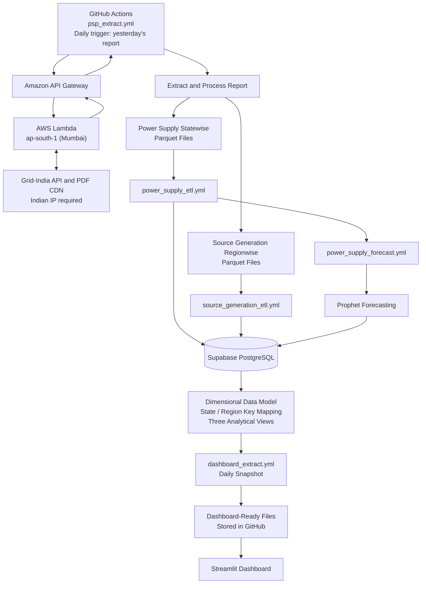

# ⚡ India Electricity Grid Analytics

An end-to-end data engineering and analytics platform for India's electricity grid. This project automates daily data extraction from Grid-India, processes power supply and regional source generation data, maintains historical Parquet datasets in GitHub, loads analytical data into Supabase PostgreSQL, generates forecasts using Prophet, and powers an interactive Streamlit dashboard.

## 🏗️ Architecture



## 📌 Project Overview

The project consists of five automated workflows that handle report extraction, ETL, forecasting, and dashboard data delivery.

### 1. Daily Data Extraction

**Workflow:** [`psp_extract.yml`](.github/workflows/psp_extract.yml)

The extraction workflow runs daily through GitHub Actions and requests the previous day's Power Supply Position (PSP) report.

The workflow calls an Amazon API Gateway endpoint, which invokes an AWS Lambda function hosted in the Asia Pacific (Mumbai) region (`ap-south-1`).

The Lambda function:

1. Authenticates incoming requests using an API key.
2. Queries the Grid-India API for the daily PSP report metadata.
3. Identifies the PDF matching the requested report date.
4. Downloads the PDF from the Grid-India CDN.
5. Returns report metadata and the Base64-encoded PDF to GitHub Actions.

The Lambda function is hosted in Mumbai because the upstream government data source requires access from an Indian IP address.

GitHub Actions then processes the extracted report and generates Parquet files for downstream workflows.

### 2. Permanent Historical Parquet Storage

Processed datasets are maintained in GitHub as permanent historical storage.

**Power Supply Statewise**
- [View dataset folder](https://github.com/tanmaymelanta/ElectricityGrid/tree/main/Power%20Supply%20Statewise)
- Contains processed state-wise power supply data.

**Source Generation Regionwise**
- [View dataset folder](https://github.com/tanmaymelanta/ElectricityGrid/tree/main/Source%20Generation%20Regionwise)
- Contains processed regional electricity generation data.

Parquet provides a columnar storage format suitable for analytical workloads and efficient processing.

These historical datasets also provide persisted outputs that can be used by downstream ETL workflows.

### 3. ETL and Database Loading

The extracted Parquet datasets are transformed and loaded into Supabase PostgreSQL through two separate GitHub Actions workflows.

**Power Supply ETL**

[`power_supply_etl.yml`](.github/workflows/power_supply_etl.yml)

- Processes state-wise power supply data.
- Applies the required transformations.
- Loads the processed records into the power supply table in Supabase PostgreSQL.

**Source Generation ETL**

[`source_generation_etl.yml`](.github/workflows/source_generation_etl.yml)

- Processes regional source generation data.
- Applies the required transformations.
- Loads the processed records into the source generation table in Supabase PostgreSQL.

Separating these workflows keeps the processing logic for the two datasets independent.

### 4. Automated Power Supply Forecasting

**Workflow:** [`power_supply_forecast.yml`](.github/workflows/power_supply_forecast.yml)

The forecasting workflow is triggered after `power_supply_etl.yml` completes.

It uses **Prophet** to forecast power supply / demand metrics and stores the resulting forecasts in a dedicated forecast table in Supabase PostgreSQL.

This integrates forecasting into the automated data pipeline, allowing forecast results to be prepared for downstream visualization without requiring manual execution.

### 5. Dimensional Data Modelling

The Supabase PostgreSQL database uses dimensional data modelling to organize the analytical datasets.

The model accounts for:

- Data grain and the level of detail represented by records.
- State and region key mapping.
- Separate subject areas for power supply, forecasts, and source generation.

Three database views expose the corresponding datasets:

1. Power Supply View
2. Forecast View
3. Source Generation View

These views provide structured data for downstream consumption and dashboard reporting.

### 6. Cost-Optimized Dashboard Data Delivery

**Workflow:** [`dashboard_extract.yml`](.github/workflows/dashboard_extract.yml)

Repeated database queries from a dashboard can increase database traffic and data-egress costs.

To address this, the dashboard extraction workflow runs once daily and extracts the required datasets from Supabase PostgreSQL. It then stores dashboard-ready output files in GitHub.

The Streamlit application reads these prepared files rather than querying Supabase repeatedly during dashboard interactions.

This architecture:

- Reduces repeated database reads.
- Helps control data-egress costs.
- Separates database processing from dashboard serving.
- Provides a predictable daily refresh cycle.

The trade-off is that dashboard data reflects the most recent successful snapshot rather than necessarily showing real-time database updates.

## 🛠️ Technology Stack

| Technology | Purpose |
|---|---|
| Python | Data extraction, processing, and transformation |
| GitHub Actions | Workflow scheduling and orchestration |
| AWS Lambda | Serverless extraction from an Indian IP |
| Amazon API Gateway | HTTP endpoint for invoking Lambda |
| Grid-India API / PDF CDN | Source for daily electricity grid reports |
| Parquet | Persistent historical analytical datasets |
| Supabase PostgreSQL | Analytical database and dimensional model |
| Prophet | Time-series forecasting |
| Streamlit | Interactive data visualization dashboard |

## 📂 Repository Structure

```text
ElectricityGrid/
│
├── .github/
│   └── workflows/
│       ├── psp_extract.yml
│       ├── power_supply_etl.yml
│       ├── source_generation_etl.yml
│       ├── power_supply_forecast.yml
│       └── dashboard_extract.yml
│
├── Power Supply Statewise/
│   └── Historical state-wise Parquet datasets
│
├── Source Generation Regionwise/
│   └── Historical regional Parquet datasets
│
├── Data Pipeline Codes/
│   └── Data processing and transformation scripts
│
├── streamlit_app/
│   └── Streamlit dashboard application
│
├── Scraper.py
├── github_upload.py
├── emission_factors.csv
├── requirements.txt
└── README.md
```

*This is a high-level representation of the repository structure; additional scripts and files may exist.*

## 🚀 Getting Started

### Prerequisites

- Python installed locally.
- Git installed locally.
- Access to the repository.
- Required credentials and configuration if you intend to run database-dependent workflows.

### 1. Clone the Repository

```bash
git clone https://github.com/tanmaymelanta/ElectricityGrid.git
cd ElectricityGrid
```

### 2. Create a Virtual Environment

```bash
python -m venv .venv
```

Activate the environment.

**Windows PowerShell**

```powershell
.\.venv\Scripts\Activate.ps1
```

**macOS / Linux**

```bash
source .venv/bin/activate
```

### 3. Install Dependencies

```bash
python -m pip install --upgrade pip
pip install -r requirements.txt
```

### 4. Run the Streamlit Dashboard

Locate the dashboard entry-point Python file inside `streamlit_app/` and execute:

```bash
streamlit run streamlit_app/<your_app_file>.py
```

Replace `<your_app_file>.py` with the actual application filename.

Ensure the dashboard's expected data files and paths are available before launching it.

## 🔐 Security Considerations

- Store database credentials, API keys, and GitHub tokens in GitHub Actions Secrets or environment variables.
- Never commit passwords, tokens, or other secrets to the repository.
- Use standard TLS certificate verification for HTTPS requests in the Lambda function.
- Review repository contents before committing large or sensitive datasets.

## 📈 Potential Future Improvements

- Add data quality checks for missing dates, duplicate records, null values, and schema changes.
- Implement retries, error notifications, and pipeline failure alerts.
- Add data freshness and last-successful-run indicators to the dashboard.
- Document fact tables, dimension tables, grain, and join keys with an ER diagram.
- Evaluate forecast accuracy through backtesting and appropriate error metrics.
- Monitor repository growth as historical Parquet datasets accumulate.
- Consider versioning or partitioning historical data to improve maintainability.

## ⚠️ Disclaimer

This project is intended for learning, analytics, and demonstration. Forecasts are estimates, and data should be validated against its original source before being used for operational or policy decisions.


#old md
# ⚡ India Electricity Grid Analytics

An end-to-end data engineering and analytics project for exploring India's electricity grid. The project collects and processes grid-related data, organizes it into datasets for analysis, and presents key insights through a Streamlit dashboard.

## Overview

ElectricityGrid brings together data pipelines and an interactive dashboard focused on:

- **State-wise power supply** — explore electricity supply information by state.
- **Regional source generation** — inspect electricity generation by source and region.
- **Forecasting** — includes forecasting-related dependencies and pipeline components.
- **Emissions analysis** — use source-specific emission factors to support estimated emissions analysis.
- **Automated data workflows** — use Python scripts and GitHub Actions to support repeatable data processing.

> **Note:** Data availability, forecast coverage, refresh frequency, and dashboard functionality depend on the current implementation and upstream data sources.

## Project structure

```text
ElectricityGrid/
├── .github/workflows/          # GitHub Actions workflows
├── Data Pipeline Codes/        # Data processing / pipeline scripts
├── Power Supply Statewise/     # State-wise power supply data or outputs
├── Source Generation Regionwise/ # Regional generation data or outputs
├── streamlit_app/              # Streamlit dashboard application
├── Scraper.py                  # Data collection / scraping entry point
├── emission_factors.csv        # Emission factors used for analysis
├── github_upload.py            # GitHub upload helper
└── requirements.txt            # Python dependencies
```

## Technology stack

- **Python** for data collection and transformation
- **Pandas** and **PyArrow** for tabular and Parquet data processing
- **SQLAlchemy** and **PostgreSQL** driver (`psycopg`) for database interactions
- **Streamlit** for the interactive dashboard
- **Prophet** for forecasting-related functionality
- **Requests** for HTTP requests
- **GitHub Actions** for workflow automation

The exact role of each dependency may vary by script; see `requirements.txt` and the individual modules for implementation details.

## Getting started

### 1. Clone the repository

```bash
git clone https://github.com/tanmaymelanta/ElectricityGrid.git
cd ElectricityGrid
```

### 2. Create and activate a virtual environment

**Windows (PowerShell):**

```powershell
python -m venv .venv
.\.venv\Scripts\Activate.ps1
```

**macOS / Linux:**

```bash
python3 -m venv .venv
source .venv/bin/activate
```

### 3. Install dependencies

```bash
python -m pip install --upgrade pip
pip install -r requirements.txt
```

### 4. Run the dashboard

The Streamlit application is located in `streamlit_app/`. Find the main Streamlit entry-point file in that directory and run it, for example:

```bash
streamlit run streamlit_app/<your_app_file>.py
```

Replace `<your_app_file>.py` with the actual application filename.

### 5. Configure data pipelines

Review the scripts in `Data Pipeline Codes/`, `Scraper.py`, and `github_upload.py` before running pipeline jobs. Configure any required database credentials, API tokens, or other settings through environment variables or a local `.env` file as appropriate to the code.

**Security:** Never commit database passwords, API keys, GitHub tokens, or other secrets to the repository. Use GitHub Actions Secrets for credentials needed by automated workflows.

## Data and interpretation

- Check the source and timestamp of each dataset before using it for analysis.
- Treat forecasts as estimates, not guaranteed future outcomes.
- Emissions figures depend on the emission factors and calculation assumptions used by the project.
- Confirm units, time resolution, missing values, and geographic coverage in the source data before comparing results.

## Roadmap ideas

Potential future improvements include:

- Documenting each pipeline's source, transformations, schedule, and output schema.
- Adding data-quality checks for missing, duplicate, and out-of-range records.
- Showing dataset freshness and pipeline status in the dashboard.
- Documenting forecasting methodology and evaluation metrics.
- Adding screenshots and a deployed dashboard link.

## Contributing

Suggestions, bug reports, and improvements are welcome. Open an issue or submit a pull request with a clear description of the change.

## Disclaimer

This project is intended for learning, analysis, and demonstration. Validate data sources, assumptions, and outputs before using results for operational or policy decisions.
